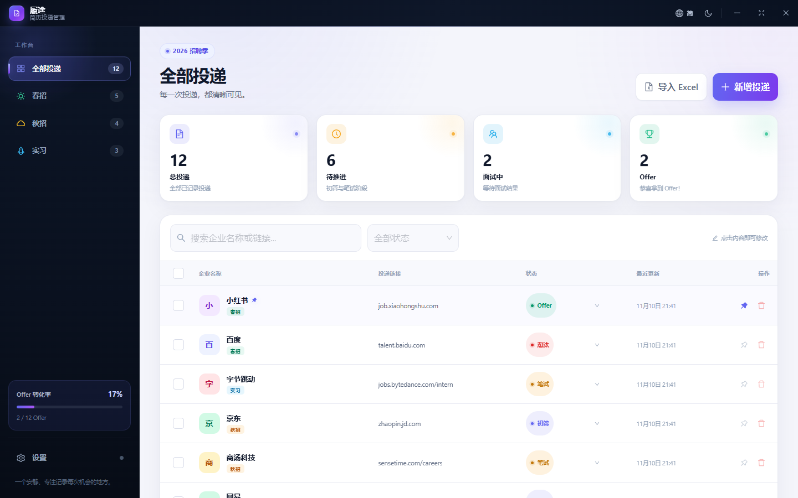
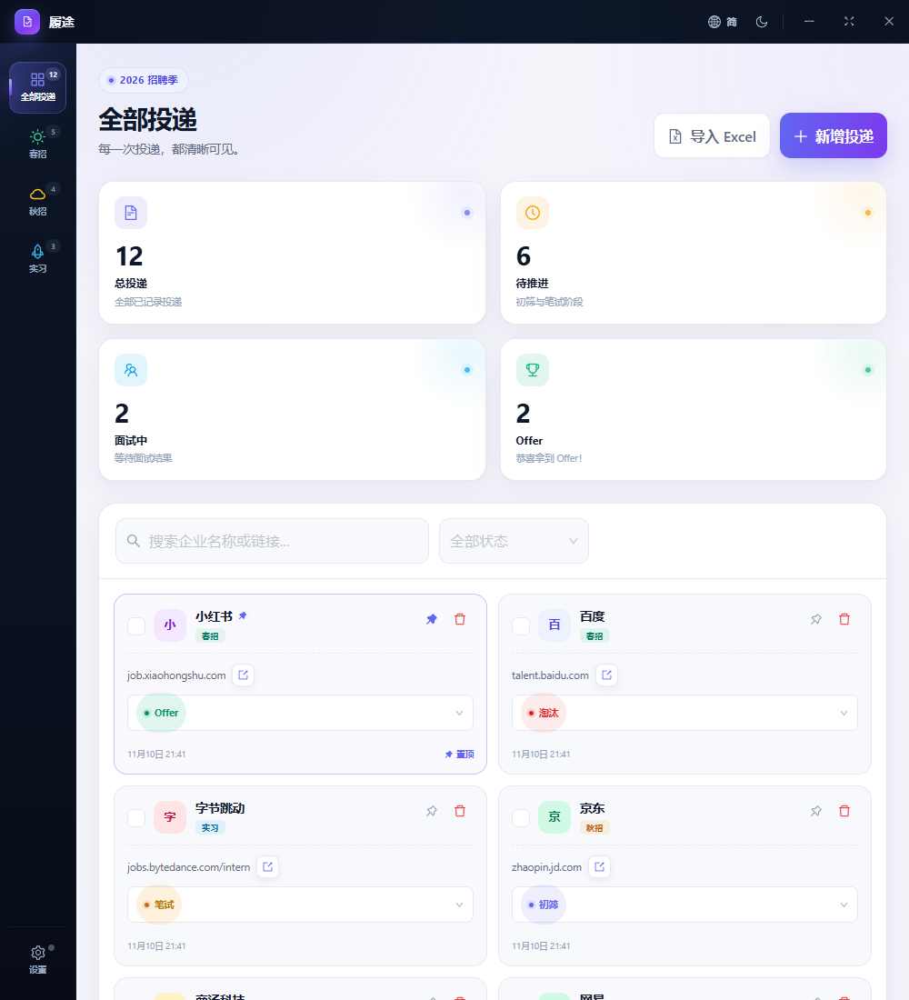

# 履途 ResumeTrail

一个专注、漂亮的简历投递记录工具。后端使用 **Go + Gin + GORM**，前端使用 **React + Ant Design**，并通过 **Wails 3** 以无边框桌面窗口运行。支持本地 SQLite、MySQL、PostgreSQL 三种数据库。



## 功能

- **置顶**：重要的投递可固定在列表最上方，始终优先展示。
- **卡片式简历库**：侧边栏独立入口，可保存多份简历；支持 DOCX、PDF、PPTX、PNG、Markdown，单文件最大 50 MB。
- **简历元数据与置顶**：每份简历可填写名称、标签并置顶；拖入文件时自动用文件名补全简历名称，卡片按置顶和上传时间排序。
- **独立简历预览窗口**：点击「查看」会打开新的 Wails 窗口，使用 [Anyview](https://github.com/harshpreet931/anyview) 原生渲染 PDF、Word、PowerPoint、图片与 Markdown（无需 iframe 或在线转换服务）；支持文本选择、全文搜索、缩略图、大纲、缩放与打印，并内置本地 PDF.js 字体 / CMap / WASM / ICC 资源，离线可用；窗口顶部是与主窗口一致的 29px 自定义标题栏，仅保留窗口置顶、最小化、全屏 / 还原和关闭。
- **便携式简历文件**：上传的原始文件保存在程序目录下的 `resume/` 文件夹，名称、标签、文件信息与置顶状态写入数据库。
- **Zap 日志**：使用 `go.uber.org/zap` 记录启动、数据库、HTTP 请求与错误信息，日志按天写入程序目录下的 `logs/` 文件夹。日志级别包含 DEBUG（调试）、INFO（常规操作）、WARN（可恢复异常）与 ERROR（需要关注的错误）。
- **三类投递看板**：春招、秋招、实习，侧边栏可快速切换并显示数量；分类使用 React Router 路由页面（`/spring`、`/autumn`、`/internship`）。
- **完整投递字段**：企业名称、投递链接、状态、投递时间；状态默认「初筛」，投递时间由后端服务器在落库时生成。
- **内联编辑**：点击企业名称或链接即可直接修改；状态下拉框即时更新。
- **表格内新增**：点击「新增投递」后直接在表格 / 卡片顶部生成可编辑草稿行，最右侧的对勾按钮保存成功后才写入数据库；取消按钮可丢弃草稿。
- **独立快速录入窗口**：约 400×170 的原生独立窗口，默认保持在其他窗口上方（标题栏可切换窗口置顶），填写企业名称与投递链接后点「加入」直接落库；成功后自动清空并提示，适合连续录入，主窗口保持原样。记录的置顶仍可在主列表中操作。
- **官网直达**：鼠标悬浮到投递链接时出现打开按钮，点击后通过系统默认浏览器打开（Wails 桌面环境）。链接按原始内容保存，不会自动添加 `http://` 或 `https://`。
- **单条删除 / 批量删除**：每行提供删除按钮，表头支持多选后批量删除。
- **批量修改状态**：多选记录后一键切换为初筛 / 笔试 / 面试 / 待定 / Offer / 淘汰。
- **搜索**：按企业名称、投递链接模糊搜索，并可按状态筛选。
- **Excel 导入**：支持 `.xlsx` / `.xlsm` 批量导入，内置中英双语模板与下拉选项，导入结果会显示成功、跳过和错误明细。
- **可选密码保护**：在设置页开启后，启动应用需要解锁；密码使用 **bcrypt** 哈希落库，绝不明文保存。
- **五种界面语言**：简体中文、繁體中文、English、日本語、한국어，包含 Ant Design 组件语言同步。
- **浅色 / 深色主题**：可在标题栏或设置页切换。
- **自定义窗口标题栏**：29px 高的紧凑标题栏，提供主题切换、最小化 / 最大化 / 关闭按钮，支持拖动窗口；品牌标识位于左侧工作台顶部。
- **可拖拽窗口尺寸**：四边与四角均可拖拽缩放，最小宽度 360px，可直接把桌面窗口缩成平板或手机尺寸，实时切换响应式布局。
- **响应式三端布局**：电脑端使用完整侧边栏 + 表格；平板端使用图标导航栏 + 双列卡片；手机端使用底部导航 + 单列卡片。
- **设置独立页面**：通过 `/settings` 路由访问，和投递工作台解耦。
- **数据统计**：总投递、待推进、面试中、Offer 数量及 Offer 转化率。
- **便携式数据**：配置文件和 SQLite 数据库默认存放在程序所在目录，不向 AppData 或其他系统目录写入数据。
- **多数据库支持**：SQLite（零配置本地存储）、MySQL、PostgreSQL，自动迁移表结构，并提供初始化 SQL 文件。
- **图形化数据库设置**：在设置页选择数据库类型、填写主机 / 端口 / 用户名 / 密码 / 数据库名，支持「测试连接」；保存后立即切换连接并写回 `config.yaml`，无需重启。
- **应用图标与桌面快捷方式**：窗口、任务栏和快捷方式统一使用 `frontend/public/logo.svg` 导出的图标；设置页可检测 / 创建桌面快捷方式，关闭应用时若桌面没有快捷方式，会打开一个独立 Wails 提示窗口询问是否创建。

## 界面预览

| 电脑端 | 平板端 | 手机端 |
| --- | --- | --- |
|  |  |  |

## 技术栈

| 层 | 技术 |
| --- | --- |
| 桌面外壳 | Wails 3（无边框窗口） |
| HTTP 后端 | Go、Gin |
| 数据访问 | GORM |
| 数据库 | SQLite（纯 Go 驱动）、MySQL、PostgreSQL |
| 密码 | bcrypt |
| Excel | excelize |
| 日志 | Zap |
| 前端 | React 18、TypeScript、Vite |
| 请求层 | Axios |
| 前端路由 | React Router |
| UI | Ant Design 5、Ant Design Icons |
| 简历预览 | Anyview（PDF / DOCX / PPTX / 图片 / Markdown） |
| 多语言 | 自研 i18n Context + Ant Design locale |

## 前端页面与路由

| 路由 | 页面 |
| --- | --- |
| `/` | 全部投递 |
| `/spring` | 春招投递 |
| `/autumn` | 秋招投递 |
| `/internship` | 实习投递 |
| `/resumes` | 简历库 |
| `/resume-preview` | 独立简历预览窗口（由应用自动打开） |
| `/settings` | 设置页 |

所有 API 请求统一通过 `src/api/client.ts` 中的 Axios 实例发送，自动附加 Bearer Token，并统一处理 401 会话过期。

## 快速开始

### 环境要求

- Go **1.26+**
- Node.js **20+** 与 npm
- Windows 10/11 需要 WebView2 Runtime（通常系统已自带）
- 其他平台按 Wails 3 要求安装对应 WebKit / 开发依赖

### 安装与运行

```bash
# 1. 安装前端依赖
npm install --prefix frontend

# 2. 构建前端（frontend/dist 会被嵌入 Go 二进制）
npm run build --prefix frontend

# 3. 启动桌面应用
go run .
```

也可以使用 Taskfile：

```bash
task install
task frontend:build
task run
```

> `main.go` 使用 `//go:embed all:frontend/dist` 嵌入前端。首次克隆后请先构建前端，否则 Go 编译会提示找不到 `frontend/dist`。

### 浏览器预览模式（无桌面窗口）

```bash
go run . --headless
# 或
RESUME_HELPER_HEADLESS=true go run .
```

启动后打开日志中打印的地址（默认 `http://127.0.0.1:19876`）。此模式适合 UI 调试；窗口控制按钮在浏览器中不会真正控制操作系统窗口。

### 构建可执行文件

```bash
task build
```

等价于：

```bash
npm run build --prefix frontend
go build -trimpath -ldflags="-s -w -H windowsgui" -o bin/resume-helper.exe .
```

Linux / macOS 构建时请去掉 `-H windowsgui`。Taskfile 已按操作系统自动处理。

## 便携式数据目录

ResumeTrail 默认**只使用程序自身目录**，不会在 C 盘的用户目录、AppData、Documents 等位置创建配置文件或数据库：

```text
ResumeTrail/
├── resume-helper.exe
├── config.yaml          # 首次启动自动生成
├── resume-helper.db     # 默认 SQLite 数据库
├── resume/              # 简历库上传的原始文件
└── logs/                # Zap 日志（按天生成）
```

- 发布版：以可执行文件所在目录为数据目录。
- 开发版（`go run .`）：以当前项目目录为数据目录，避免写入 Go 临时构建目录。
- 自定义数据目录：设置环境变量 `RESUME_HELPER_DATA_DIR`。
- 自定义配置文件：设置环境变量 `RESUME_HELPER_CONFIG`（文件必须存在）。
- 如果程序放在只读目录（例如 `C:\Program Files`）且无法创建配置，请将整个程序文件夹移动到可写位置，或设置 `RESUME_HELPER_DATA_DIR`。

SQLite 的 `dsn` 为空时默认使用程序目录下的 `resume-helper.db`；相对路径也会基于配置所在目录解析，因此整个文件夹可以整体移动。

## 配置数据库

推荐直接在应用内「设置 → 数据库」中图形化配置：选择 SQLite / MySQL / PostgreSQL，填写连接信息，先点「测试连接」，再点「保存并应用」。应用会立即切换数据库连接并把配置写回 `config.yaml`，无需重启。切换数据库不会复制旧库数据，请确认目标库已存在且包含所需数据。

首次启动会在程序目录（开发模式下为项目根目录）自动生成 `config.yaml`。也可以复制 `config.example.yaml` 后手动修改并重启。

### SQLite（默认）

```yaml
server:
  host: 127.0.0.1
  port: 19876

database:
  driver: sqlite
  dsn: ""
```

### MySQL

```yaml
database:
  driver: mysql
  dsn: "user:password@tcp(127.0.0.1:3306)/resume_helper?charset=utf8mb4&parseTime=True&loc=Local"
```

手动初始化数据库：

```bash
mysql -u root -p < init.mysql.sql
```

### PostgreSQL

```yaml
database:
  driver: postgres
  dsn: "host=127.0.0.1 user=postgres password=secret dbname=resume_helper port=5432 sslmode=disable TimeZone=Local"
```

手动初始化数据库：

```bash
createdb resume_helper
psql -d resume_helper -f init.postgresql.sql
```

项目根目录提供：

- `init.mysql.sql`（项目根目录）：创建 `resume_helper` 数据库、`applications`、`resumes` 与 `settings` 表及索引。
- `init.postgresql.sql`（项目根目录）：创建 `applications`、`resumes` 与 `settings` 表及索引（在目标数据库中执行）。

> 应用启动时仍会自动执行 GORM `AutoMigrate`。初始化 SQL 主要用于手动建库、DBA 审核或查看实体结构。

### 环境变量覆盖

| 变量 | 说明 |
| --- | --- |
| `RESUME_HELPER_CONFIG` | 指定 config.yaml 路径（必须存在） |
| `RESUME_HELPER_DATA_DIR` | 指定配置与默认数据库所在目录 |
| `RESUME_HELPER_HOST` | 监听地址，默认 `127.0.0.1` |
| `RESUME_HELPER_PORT` | 监听端口，默认 `19876`；端口被占用时会自动使用随机端口 |
| `RESUME_HELPER_DB_DRIVER` | `sqlite` / `mysql` / `postgres` |
| `RESUME_HELPER_DB_DSN` | 数据库 DSN |
| `RESUME_HELPER_HEADLESS` | `true` / `1` 时仅启动 Gin 服务 |

## 密码保护

- 密码是**可选项**：默认关闭，可在「设置 → 安全」中开启。
- 开启后，应用启动时显示解锁界面；会话保存在内存中，有效期 24 小时，应用重启后需要重新解锁。
- 数据库中仅保存 bcrypt 哈希（`settings` 表的 `auth.password_hash`），不会保存明文密码。
- 支持修改密码、立即锁定、关闭密码保护。
- 如果忘记密码，可在确认数据库中无重要数据后，删除数据库文件并重新启动；也可手动删除 `settings` 表中 `auth.password_hash` 记录。

## Excel 导入

在「导入 Excel」弹窗中可下载模板，然后拖入文件。数据写入第一个工作表，表头支持以下别名（不区分大小写）：

| 字段 | 支持的表头 |
| --- | --- |
| 大分类 | `Category`、`大分类`、`分类`、`类别`、`招聘类型`、`採用区分`、`채용유형` |
| 企业名称 | `Company`、`Company Name`、`企业名称`、`公司名称`、`企业`、`公司`、`会社名`、`기업명`、`회사명` |
| 投递链接 | `Link`、`URL`、`Application Link`、`投递链接`、`链接`、`网址`、`応募リンク`、`지원링크` |
| 状态 | `Status`、`状态`、`进度`、`進捗`、`진행상태` |

分类与状态支持多语言写法：

- 分类：`spring` / `春招` / `春採用` / `봄 채용` 等
- 状态：`screening` / `初筛` / `書類選考` / `서류 전형`、`pending` / `待定` 等

规则：

- 企业名称必填；链接可选，按原样保存，不会自动补全 `http://` 或 `https://`。
- 分类为空默认春招，状态为空默认初筛；投递时间由服务器在导入时生成。
- 单文件最大 10 MB、最多 5000 行。
- 无法识别的分类或状态会跳过该行，并在结果中显示行号和原因。
- 只支持 `.xlsx` / `.xlsm`，不支持旧版 `.xls`。

## API 概览

| 方法 | 路径 | 说明 |
| --- | --- | --- |
| `GET` | `/api/health` | 健康检查 |
| `GET` | `/api/auth/status` | 密码状态与当前会话状态 |
| `POST` | `/api/auth/login` | 解锁 |
| `POST` | `/api/auth/setup` | 首次设置密码 |
| `POST` | `/api/auth/change-password` | 修改密码 |
| `POST` | `/api/auth/disable` | 关闭密码保护 |
| `POST` | `/api/auth/logout` | 注销会话 |
| `GET` | `/api/applications` | 分页列表，支持 `search`、`category`、`status`；置顶记录优先 |
| `POST` | `/api/applications` | 新增投递 |
| `PUT` | `/api/application/:id` | 局部更新（企业、链接、状态、分类、置顶） |
| `DELETE` | `/api/application/:id` | 删除单条 |
| `POST` | `/api/applications/batch-delete` | 批量删除 |
| `PATCH` | `/api/applications/batch-status` | 批量修改状态 |
| `POST` | `/api/applications/import` | 上传 Excel 导入 |
| `GET` | `/api/applications/template` | 下载导入模板 |
| `GET` | `/api/resumes` | 简历列表，置顶优先，支持 `search` |
| `POST` | `/api/resumes` | 上传简历（multipart：`name`、`tags`、`file`） |
| `GET` | `/api/resume/:id` | 单份简历元数据 |
| `PUT` | `/api/resume/:id` | 更新名称 / 标签 / 置顶 |
| `DELETE` | `/api/resume/:id` | 删除简历记录与文件 |
| `GET` | `/api/resume/:id/file` | 读取原始文件（`download=1` 强制下载） |
| `GET` | `/api/stats` | 分类 / 状态 / 简历数量统计 |
| `GET` | `/api/system/info` | 数据库、配置文件、版本信息 |
| `GET` | `/api/system/database` | 当前数据库的图形化配置字段 |
| `POST` | `/api/system/database/test` | 测试数据库连接（不保存） |
| `PUT` | `/api/system/database` | 保存配置、迁移新库并立即切换连接 |
| `GET` | `/api/system/shortcut` | 查询桌面快捷方式状态 |
| `POST` | `/api/system/shortcut` | 创建桌面快捷方式 |
| `POST` | `/api/system/shortcut/prompt` | 处理关闭时的快捷方式提示窗口选择 |
| `POST` | `/api/system/quick-entry` | 打开独立的快速录入窗口 |
| `POST` | `/api/system/resume-preview` | 打开独立的简历预览窗口 |

开启密码后，除健康检查、认证接口和静态资源外，其余 `/api` 请求需要携带：

```http
Authorization: Bearer <token>
```

## 响应式布局

| 端 | 断点 | 布局 |
| --- | --- | --- |
| 电脑 | ≥ 1200px | 完整侧边栏、统计卡片四列、桌面数据表格 |
| 平板 | 768–1199px | 84px 图标导航栏、两列统计、双列投递卡片 |
| 手机 | < 768px | 底部导航栏、单列投递卡片、筛选与操作全宽排列 |

桌面窗口最小可缩放到 **360 × 480**，因此可以直接拖拽窗口四边 / 四角，实时预览平板与手机布局。

布局与组件解耦：`useMediaQuery` 负责切换列表形态，`ApplicationTable` 与 `ApplicationCards` 复用同一套企业、链接、状态和操作子组件。

## 开发

```bash
# 终端 1：启动 Gin（无桌面窗口）
go run . --headless

# 终端 2：启动 Vite，/api 会代理到 http://127.0.0.1:19876
cd frontend
npm run dev
```

Vite 默认运行在 `http://127.0.0.1:9245`，可通过 `RESUME_HELPER_API` 环境变量修改代理目标。

前端生产构建后才能被 Go 的 `embed` 使用。

### 测试

```bash
go test ./...
```

覆盖投递 CRUD、搜索、统计、批量操作、置顶、可选密码、Excel 模板与导入、简历上传/拖拽路径导入/预览/删除，以及便携式配置目录行为。

## 项目结构

```text
.
├── main.go                              # Wails 窗口 + Gin 启动入口
├── init.mysql.sql                       # MySQL 初始化脚本
├── init.postgresql.sql                  # PostgreSQL 初始化脚本
├── config.example.yaml
├── internal/
│   ├── config/                          # 便携式配置加载与环境变量
│   ├── database/                        # 多数据库连接、DSN 解析/构建、测试连接、迁移
│   ├── desktop/                         # Windows 桌面快捷方式检测与创建
│   ├── logging/                         # Zap 日志初始化（logs 目录）
│   ├── models/                          # GORM 实体（Application、Resume、Setting）
│   └── server/                          # Gin 路由、CRUD、认证、Excel、简历、数据库设置
├── frontend/
│   ├── src/
│   │   ├── api/                         # Axios 客户端与类型
│   │   ├── components/
│   │   │   ├── applications/            # 表格、卡片、草稿新增行、单元格、状态与操作
│   │   │   ├── dashboard/               # 页头、工具栏、批量操作栏
│   │   │   ├── resumes/                 # 简历上传弹窗
│   │   │   └── settings/                # 外观、安全、图形化数据库、关于
│   │   ├── hooks/                       # useApplications、useApplicationDraft、useInlineEdit、useMediaQuery
│   │   ├── layouts/WorkspaceLayout.tsx  # 路由嵌套布局与上下文
│   │   ├── pages/
│   │   │   ├── Dashboard.tsx            # 投递工作台
│   │   │   ├── ResumeLibraryPage.tsx    # 简历库
│   │   │   ├── ResumePreviewWindowPage.tsx # 独立简历预览窗口
│   │   │   └── SettingsPage.tsx         # 设置页
│   │   ├── i18n/                        # 五种语言
│   │   └── styles/global.css            # 全局与三端响应式样式
│   └── vite.config.ts
└── Taskfile.yml
```

## 数据与隐私

- 配置文件和 SQLite 数据库默认都位于程序目录，不会主动写入 C 盘用户目录或系统目录。
- 所有数据保存在本地数据库，不包含任何遥测或上传逻辑。
- 密码只以 bcrypt 哈希存储。
- 导入的 Excel 文件只在内存中解析，不保留临时副本。
- 简历原始文件保存在程序目录的 `resume/` 文件夹；删除简历时会同时删除对应文件。
- 运行日志保存在程序目录的 `logs/` 文件夹，不包含简历文件内容或密码明文。
- MySQL / PostgreSQL 的 DSN 会出现在用户自己的配置文件中，请妥善保管该文件。

## 已知说明

- 桌面窗口通过 Wails 3 提供，因此需要 WebView2 / WebKit 运行环境；浏览器预览模式下窗口按钮不会控制真实窗口。
- 如果程序目录不可写（例如安装在 Program Files），启动时会在日志中提示；请移动到可写目录或设置 `RESUME_HELPER_DATA_DIR`。
- 仅支持 `.xlsx` / `.xlsm`，不支持旧版 `.xls`。
- 当前界面语言与主题保存在浏览器 `localStorage` 中。
